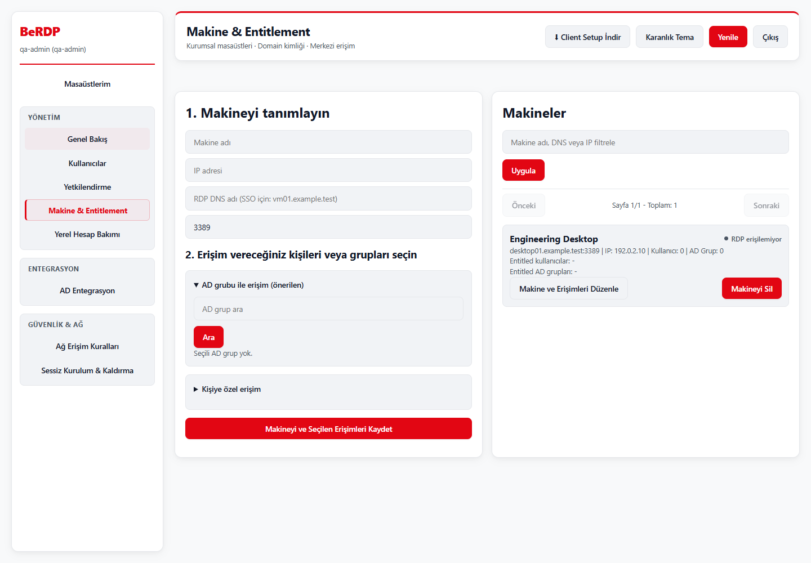
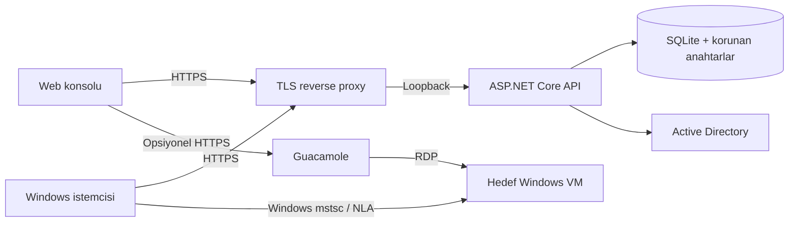

# BeRDP

**Windows masaüstlerine merkezi, ajan gerektirmeyen erişim.**

BeRDP, kurum içindeki RDP makinelerini, kullanıcıları ve Active Directory grup atamalarını tek yerden yönetir. Windows istemcisi yerleşik `mstsc.exe` ile bağlanır; web konsolu envanter ve erişim yönetimini sunar. Hedef VM'lere BeRDP ajanı yüklemek gerekmez.

**1.6.0 · Windows x64 · .NET 10 · MIT · Berkay Atağ**

[Tanıtım sayfası](https://berkayatag.github.io/BeRDP/) · [İndir](https://github.com/BerkayAtag/BeRDP/releases/tag/v1.6.0-rc.1) · [Windows kurulum testi](https://github.com/BerkayAtag/BeRDP/actions/runs/40738303817)

> Sürüm adayı: yerel otomatik testler tamamlandı. Temiz Windows kurulum, yeniden kurulum ve kaldırma testleri geçti. Gerçek AD/Kerberos, kurum TLS proxy'si, hedef VM, eski sürümden yükseltme ve geri yükleme kabul testleri kurumun pilot ortamında tamamlanmalıdır. Kod imzalama sertifikası bu projeye dahil değildir.



## Neler yapar?

- Web konsolunda makine, yerel kullanıcı, AD kullanıcısı ve grup bazlı erişim yönetimi.
- Yerel parola veya yapılandırılmış Windows Negotiate / AD kimlik doğrulaması.
- WPF istemcisinde makine arama, açık/koyu tema, çoklu ekran ve RDP kaynak seçimi.
- Bağlanmadan önce güncel makine atamasının yeniden doğrulanması.
- Opsiyonel Apache Guacamole entegrasyonu ile tarayıcıdan RDP.
- Server ve Client için ayrı, self-contained Windows kurulum paketleri.
- Boş başlangıç: otomatik test hesabı, demo makine veya varsayılan yönetici parolası yoktur.

BeRDP bir hypervisor, VM provisioning sistemi veya RDP ağ geçidi değildir. Doğrudan RDP erişimini Windows oturum açma hakları, NLA, GPO ve güvenlik duvarı yönetir. BeRDP atamasının silinmesi açık bir Windows oturumunu sonlandırmaz. Windows Hello desteği etki alanı/Kerberos yapılandırmasına bağlıdır; bütün ortamlarda parola gerektirmeyen RDP garantisi verilmez.

## İndirme ve kurulum

Yayınlanan sürümlerde [Releases](https://github.com/BerkayAtag/BeRDP/releases) bölümünden `BeRDP.Server.Setup.exe`, `BeRDP.Client.Setup.exe` ve `SHA256SUMS.txt` indirilir. Kaynaktan üretim çıktıları `dist/installers/` dizinindedir. Public depo: [BerkayAtag/BeRDP](https://github.com/BerkayAtag/BeRDP).

1. [Kurulum rehberini](docs/INSTALLATION_GUIDE.md) uygulayın.
2. Sunucuyu TLS reverse proxy arkasında, yalnız loopback dinleyicileriyle çalıştırın.
3. Konsolda `--bootstrap-admin` ile kendi ilk yöneticinizi oluşturun.
4. Makine ve kullanıcı/grup atamalarını tanımlayın; Windows RDP haklarını ayrıca düzenleyin.
5. İstemciyi kurumun HTTPS API adresiyle dağıtın.

```powershell
.\BeRDP.Client.Setup.exe /VERYSILENT /SUPPRESSMSGBOXES /NORESTART /BACKENDURL="https://berdp.example.test/api" /SSO=0
```

İmzasız paketlerde Windows UAC doğrulanmış yayıncı göstermez. Programlar ve Özellikler (`appwiz.cpl`) yayıncı alanı `AppPublisher=Berkay Atağ` ile tanımlanır. Setup metadata'sı **Berkay Atağ** olsa da doğrulanmış yayıncı için bu kimlikle eşleşen güvenilir Authenticode sertifikasıyla imzalama gerekir.

## Mimari



| Bileşen | Konum | Görev |
|---|---|---|
| API | `src/BeRdp.Backend` | JWT, AD, yetki, SQLite, SignalR |
| Portal | `src/BeRdp.AdminConsole` | Statik JS/CSS yönetim arayüzü |
| İstemci | `src/BeRdp.Client` | WPF ve Windows RDP başlatıcısı |
| Servis kurulumu | `src/BeRdp.ServiceSetup` | Servisler, özel dizin ACL'leri, yapılandırma |
| Paketleme | `installer` | Inno Setup ve temiz derleme |

## Geliştirme ve doğrulama

Windows x64, .NET 10 SDK ve paketleme için Inno Setup 6 gerekir. Paketler .NET çalışma zamanını içerir. SDK seçimi `global.json`, bağımlılıklar `packages.lock.json` dosyalarıyla izlenir.

```powershell
dotnet run --project tests/BeRdp.Regression -c Release
dotnet run --project src/BeRdp.ServiceSetup -c Release -- --self-test
powershell -NoProfile -File installer/Build-Installers.ps1
```

Gerçek HTTP/tarayıcı testi: [tests/README.md](tests/README.md). Ayrıntılı sonuç ve sınırlar: [doğrulama raporu](docs/VALIDATION.md).

## Belgeler

- [Kurulum, yükseltme ve TLS](docs/INSTALLATION_GUIDE.md)
- [İlk yönetici ve parola kurtarma](docs/Admin-Credentials.md)
- [Ağ sınırları](docs/Firewall.md) · [API](docs/Api.md)
- [Güvenlik düzeltmeleri ve kalan kabul testleri](docs/SECURITY-REVIEW.md)
- [GitHub araştırması ve gelişim yol haritası](docs/ROADMAP.md)
- [Sürüm hazırlığı](docs/RELEASING.md) · [Değişiklikler](CHANGELOG.md)
- [Güvenlik bildirimi](SECURITY.md) · [Katkı](CONTRIBUTING.md)

## Lisans

[MIT](LICENSE), © 2026 Berkay Atağ. Üçüncü taraf bileşenler kendi lisanslarına tabidir. Ekran görüntülerindeki kişiler ve makineler geçici, sentetik QA verileridir; kurulum paketlerinde bulunmaz.
