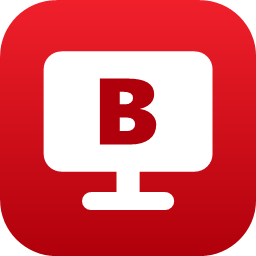
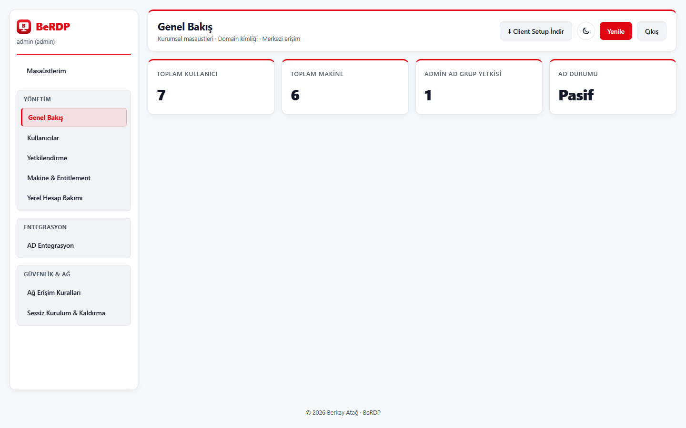
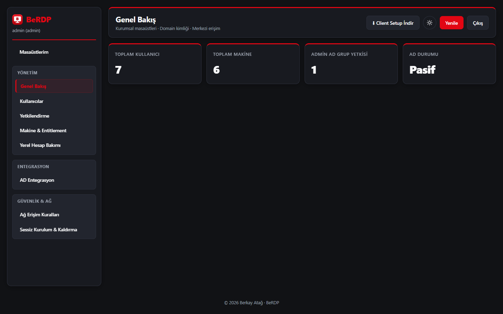
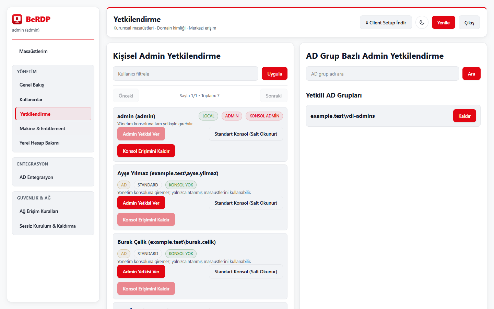
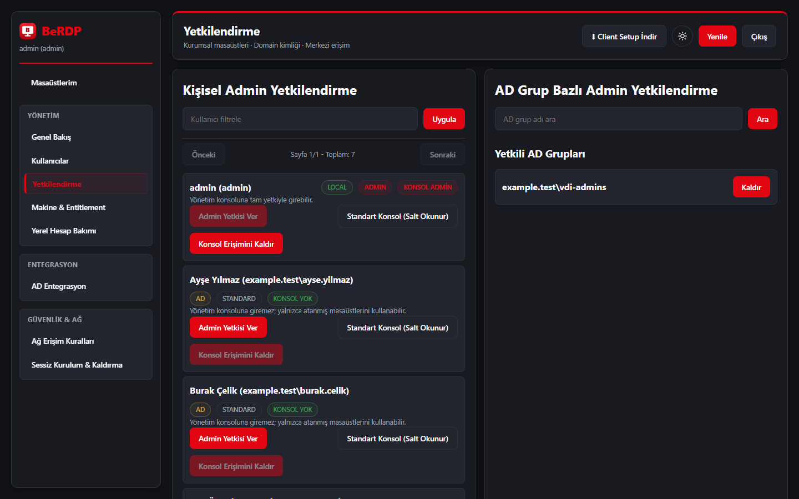
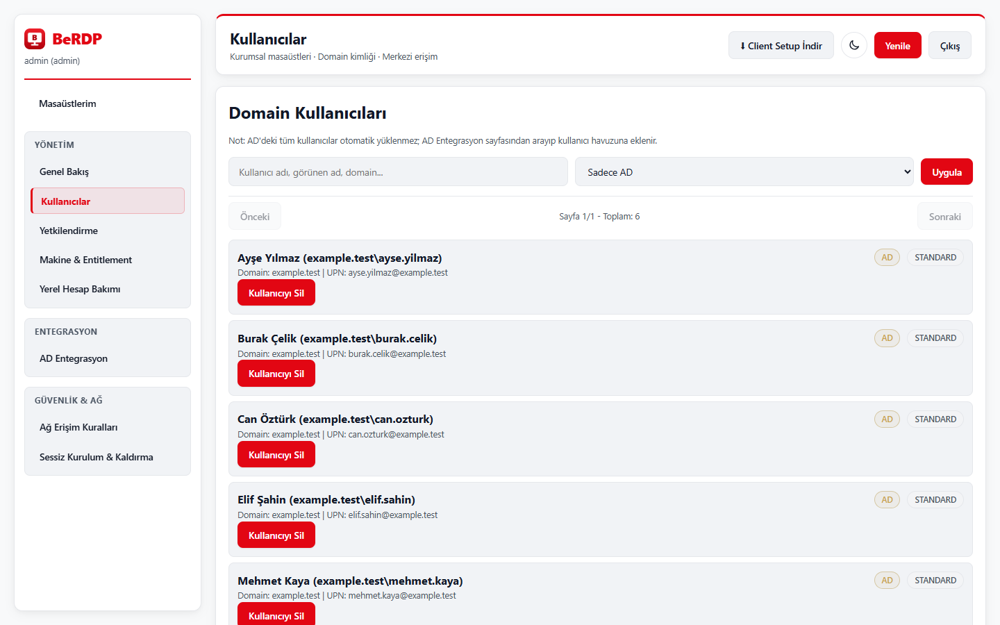
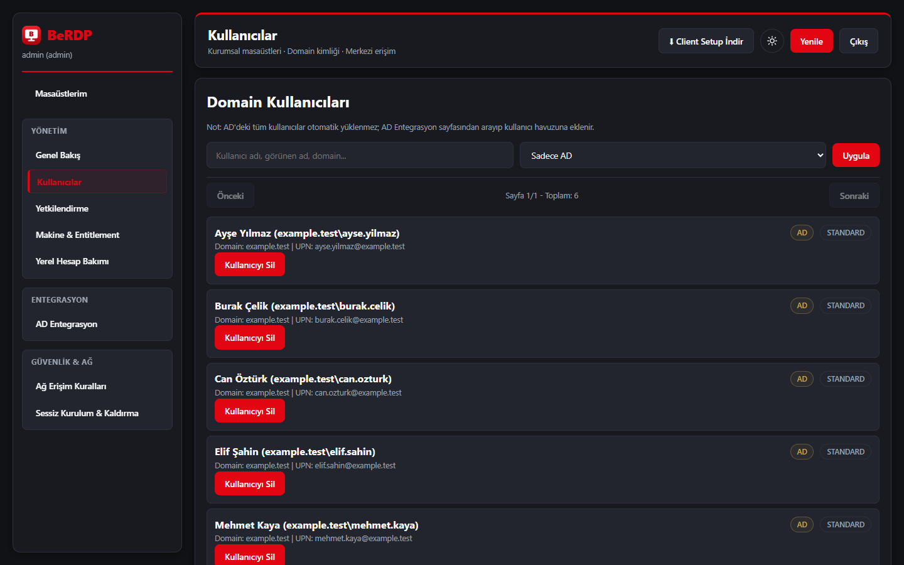
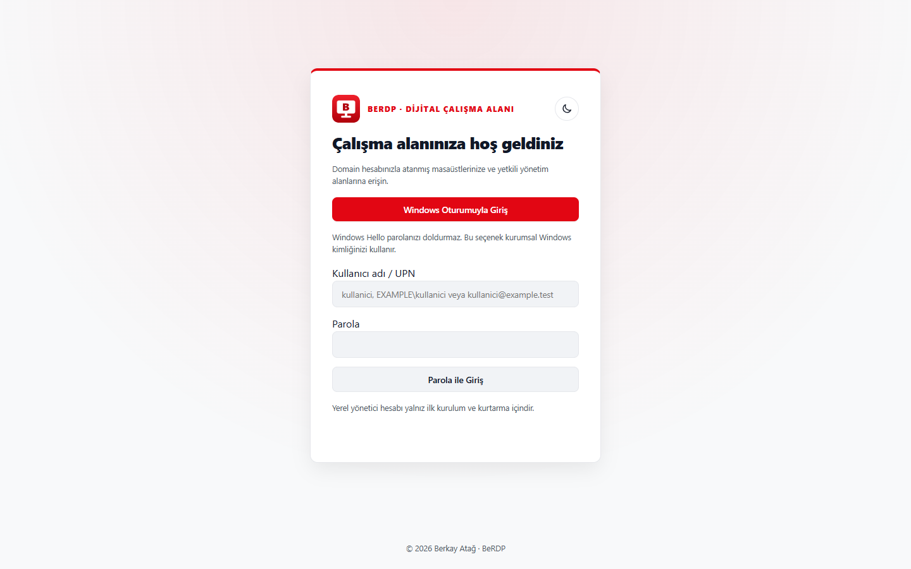
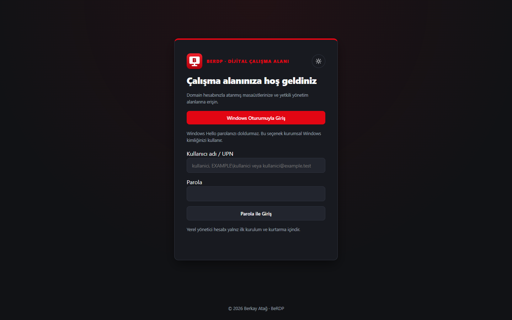
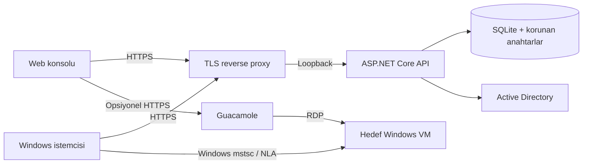

<p align="center"></p>

<h1 align="center">BeRDP</h1>

<p align="center"><strong>Windows masaüstlerine merkezi, ajan gerektirmeyen erişim.</strong></p>

<p align="center">
  <a href="https://berkayatag.github.io/BeRDP/">Tanıtım sayfası</a> ·
  <a href="https://github.com/BerkayAtag/BeRDP/releases/latest">İndir</a> ·
  <a href="docs/INSTALLATION_GUIDE.md">Kurulum rehberi</a> ·
  <a href="CHANGELOG.md">Değişiklikler</a>
</p>

<p align="center">1.7.0 · Windows x64 · .NET 10 (pakete dahil) · MIT · Berkay Atağ</p>

BeRDP, kurum içindeki RDP makinelerini, kullanıcıları ve Active Directory grup atamalarını tek yerden yönetir. Windows istemcisi yerleşik `mstsc.exe` ile bağlanır; web konsolu envanter ve erişim yönetimini sunar. Hedef VM'lere BeRDP ajanı yüklemek gerekmez.

<picture>
  <source media="(prefers-color-scheme: dark)" srcset="docs/ui/machines-dark.png">
  
</picture>

## Neler yapar?

- **Kimliğe bağlı erişim:** Makineleri kişilere veya AD gruplarına atayın; atama her bağlantıdan hemen önce sunucuda yeniden doğrulanır.
- **Windows ile doğal bağlantı:** WPF istemcisi `mstsc` ile bağlanır; makine arama, çoklu ekran, çözünürlük ve yerel kaynak seçimi, açık/koyu tema.
- **Active Directory ve SSO:** AD kullanıcı/grup arama, grup bazlı yönetici yetkisi, isteğe bağlı Windows Negotiate (Kerberos) girişi.
- **Rol tabanlı konsol:** Tam yetkili yönetici, salt okunur konsol ve yalnız masaüstü kullanıcısı; yetki değişikliği bir sonraki istekte geçerlidir.
- **Güvenli varsayılanlar:** Varsayılan parola veya demo hesap yok; servisler yalnız loopback dinler, uzak erişim HTTPS ister, anahtarlar DPAPI ile korunur.
- **Tarayıcıdan RDP (opsiyonel):** Apache Guacamole ile kısa ömürlü, imzalı bağlantı biletleri.

BeRDP bir hypervisor, VM provisioning sistemi veya RDP ağ geçidi değildir. Doğrudan RDP erişimini Windows oturum açma hakları, NLA, GPO ve güvenlik duvarı yönetir; BeRDP atamasının silinmesi açık bir Windows oturumunu sonlandırmaz.

## Ekranlar

| Aydınlık | Karanlık |
|---|---|
|  |  |
|  |  |
|  |  |
|  |  |

Ekranlardaki kişiler, makineler ve gruplar sentetik demo verisidir; kurulum paketlerinde bulunmaz.

## İndirme ve kurulum

[Son sürüm](https://github.com/BerkayAtag/BeRDP/releases/latest) sayfasından `BeRDP.Server.Setup.exe`, `BeRDP.Client.Setup.exe` ve `SHA256SUMS.txt` dosyalarını indirin. Her iki paket de tıkla-kur şeklindedir ve .NET kurulumu gerektirmez. Programlar ve Özellikler (`appwiz.cpl`) listesinde yayıncı **Berkay Atağ**, simge kırmızı BeRDP logosudur.

1. **Sunucu:** `BeRDP.Server.Setup.exe` dosyasını çift tıklayın. Sihirbaz ilk yönetici kullanıcı adı ve parolasını sorar (en az 14 karakter); *Kur* dedikten sonra servisler kurulur ve yönetim konsolu `http://localhost:5173` adresinde açılır.
2. **Erişim:** Konsolda makineleri ekleyin; kişileri veya AD gruplarını atayın. Kurumsal kullanım için servisleri kurum sertifikanızla bir TLS reverse proxy arkasında yayınlayın ([kurulum rehberi](docs/INSTALLATION_GUIDE.md)).
3. **İstemci:** `BeRDP.Client.Setup.exe` sunucu adresini sorar. Toplu dağıtım için:

```powershell
.\BeRDP.Client.Setup.exe /VERYSILENT /SUPPRESSMSGBOXES /NORESTART /BACKENDURL="https://berdp.example.test/api" /SSO=0
```

Paketler Authenticode ile imzalı değildir; SmartScreen uyarısında "Ek bilgi → Yine de çalıştır" seçilir. Doğrulanmış yayıncı için Berkay Atağ kimliğiyle eşleşen güvenilir bir kod imzalama sertifikası gerekir. Gerçek AD/Kerberos, kurum TLS proxy'si, hedef VM ve eski sürümden yükseltme kabul testleri kurumun pilot ortamında tamamlanmalıdır.

## Mimari



| Bileşen | Konum | Görev |
|---|---|---|
| API | `src/BeRdp.Backend` | JWT, AD, yetki, SQLite, SignalR |
| Portal | `src/BeRdp.AdminConsole` | Statik JS/CSS yönetim arayüzü |
| İstemci | `src/BeRdp.Client` | WPF ve Windows RDP başlatıcısı |
| Servis kurulumu | `src/BeRdp.ServiceSetup` | Servisler, özel dizin ACL'leri, yapılandırma |
| Paketleme | `installer`, `branding` | Inno Setup, logo ve temiz derleme |

## Geliştirme ve doğrulama

Windows x64, .NET 10 SDK ve paketleme için Inno Setup 6 gerekir. SDK seçimi `global.json`, bağımlılıklar `packages.lock.json` dosyalarıyla izlenir.

```powershell
dotnet run --project tests/BeRdp.Regression -c Release
dotnet run --project src/BeRdp.ServiceSetup -c Release -- --self-test
powershell -NoProfile -File installer/Build-Installers.ps1
```

Gerçek HTTP/tarayıcı testi ve ekran görüntüsü üretimi: [tests/README.md](tests/README.md). Her `main` değişikliği GitHub'ın temiz Windows çalıştırıcısında kurulur, appwiz Publisher/simge kaydı, servis sağlığı, ilk yönetici oluşturma, yeniden kurulum ve kaldırma doğrulanır. Ayrıntılı sonuç ve sınırlar: [doğrulama raporu](docs/VALIDATION.md).

## Belgeler

- [Kurulum, yükseltme ve TLS](docs/INSTALLATION_GUIDE.md)
- [İlk yönetici ve parola kurtarma](docs/Admin-Credentials.md)
- [Ağ sınırları](docs/Firewall.md) · [API](docs/Api.md)
- [Güvenlik düzeltmeleri ve kalan kabul testleri](docs/SECURITY-REVIEW.md)
- [Yol haritası](docs/ROADMAP.md) · [Sürüm hazırlığı](docs/RELEASING.md)
- [Güvenlik bildirimi](SECURITY.md) · [Katkı](CONTRIBUTING.md)

## Lisans

[MIT](LICENSE). Üçüncü taraf bileşenler kendi lisanslarına tabidir ([envanter](docs/THIRD-PARTY.md)).

<p align="center">© 2026 Berkay Atağ · BeRDP</p>
